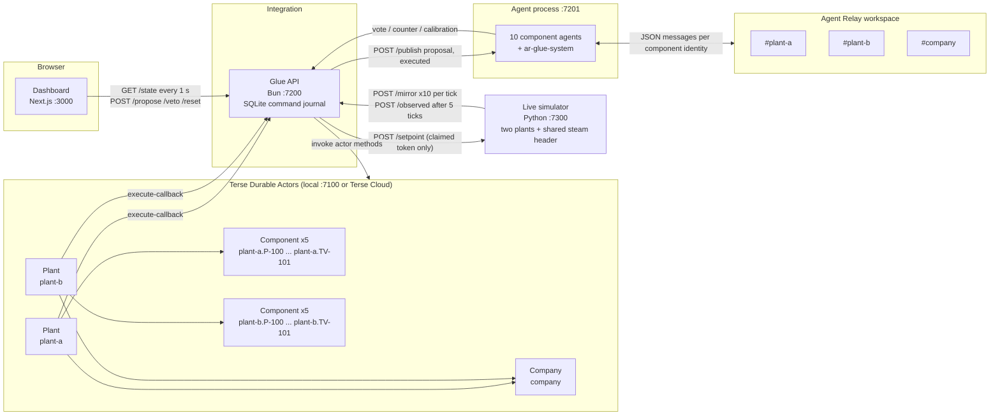
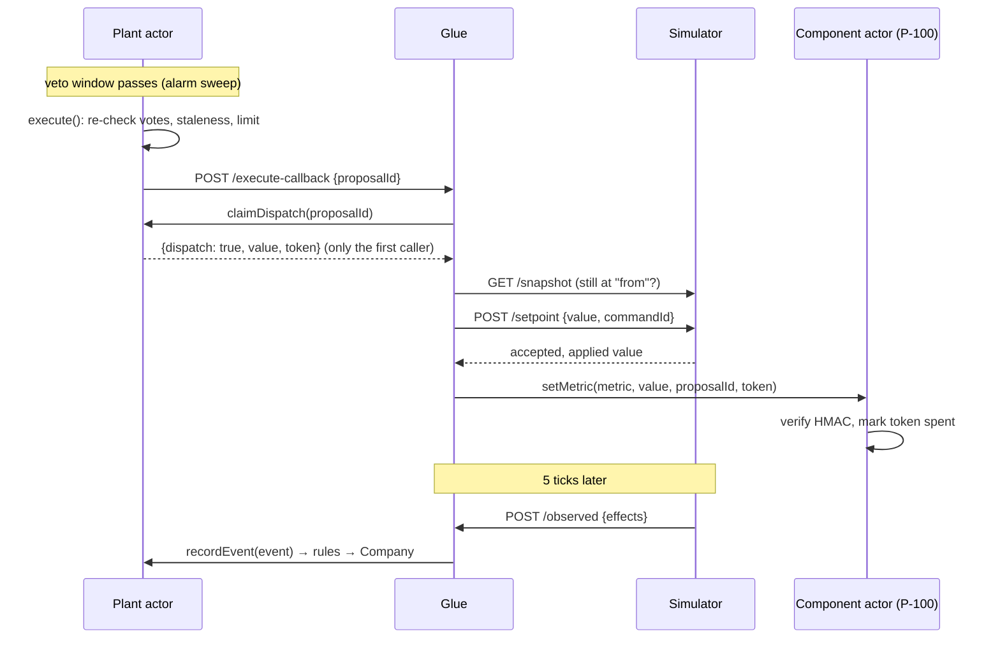

# ActorRelay

Every component in a process plant gets its own agent and its own durable memory. No setpoint changes unless every connected component agrees, and every agent learns from what happened the last time.

ActorRelay is a control layer on top of a simulated heated hold tank (TK-101), running as two identical plants that share one steam header. A change is a proposal. The connected components' agents predict the effect on their own equipment, cite past runs as evidence, and vote. One "no" blocks the change. A unanimous "yes" opens a 10 second human veto window, then the change is written to the simulator. Five ticks later the observed result goes back into every agent's memory, and the next vote is judged against it.

> Simulated plant only. No real PLC, no real plant data.

Built for Haunted Hacks at Y Combinator (Oct 31, 2026). Two sponsor technologies carry the system:

| | What it does in ActorRelay |
|---|---|
| **Terse Durable Actors** (`terse-sdk` 0.14.9) | 13 durable actors (10 components, 2 plants, 1 company) hold all state: live metrics, limits, proposals, votes, history, calibration, learned rules, audit. They enforce the safety rules, run the clock with alarms, and gate every write with a one-time token. There is no other database. |
| **Agent Relay** (`@agent-relay/sdk` 15.0.1) | 10 component agents plus a system participant talk on `#plant-a`, `#plant-b` and `#company`. Proposals, votes, counter-proposals, cross-plant votes and "executed" broadcasts are Relay messages, each sent under the identity of the component that is speaking. |

---

## Contents

1. [The 90 second demo](#the-90-second-demo)
2. [Architecture](#architecture)
3. [Durable Actors in depth](#durable-actors-in-depth)
4. [Agent Relay in depth](#agent-relay-in-depth)
5. [How an agent votes](#how-an-agent-votes)
6. [Usage evidence: calls, messages, traces](#usage-evidence-calls-messages-traces)
7. [The plant](#the-plant)
8. [Running it](#running-it)
9. [Repository layout](#repository-layout)

---

## The 90 second demo

1. The dashboard shows the company tree (Company, plant-a, plant-b, components), the plant with live values from the simulator, the proposal panel, and a trend chart.
2. The operator clicks **Increase throughput** on plant-a. The P-100 feed pump proposes speed 50 → 85 %. Voters light up: TK-101, LV-101, E-101, TV-101, plus plant-b's TV-101, because both plants draw steam from the same header.
3. **LV-101 votes NO.** It predicts the outlet valve at ~89 % (85 % steady plus overshoot) against its 81 % threshold (critical 90 minus a 10 % margin), and cites past plant-a runs where the valve ran out of travel, plus a learned rule. The proposal is **blocked**.
4. P-100's agent **counter-proposes** the highest speed the history shows safe for every blocking voter (≈70 %). All five voters say yes. The 10 second veto window runs out, the Plant actor approves the write, the simulator moves, and LV-101 settles where predicted. Each agent logs predicted vs observed.
5. The operator asks for 85 % again. It is **blocked faster**, and LV-101's first piece of evidence is the run that executed a minute ago. *It learned.*
6. Switch to plant-b, which has never run above 80 %. Propose 85 %. plant-b's LV-101 votes **NO** citing the company rule learned in plant-a. *Plant B learned from Plant A.*

---

## Architecture



| Service | Port | Owns |
|---|---|---|
| `actor/` Durable actors | 7100 (local) or Terse Cloud | All state and all decision rules |
| `bridge/live_sim.py` Simulator | 7300 | Mass and energy balances, PI controllers, shared steam header |
| `glue/` Integration API | 7200 | HTTP surface for the dashboard, simulator and agents; dispatch journal; Relay outbox |
| `agent/` Component agents | 7201 | 10 agents on Agent Relay; retrieval, prediction, voting, counter-proposals, calibration |
| `web/` Dashboard | 3000 | Renders only actor state (`PlantState`, `ComponentState`, `CompanyState`) |

The data contract is one file, `shared/types.ts`. Every actor emits exactly these types, and the dashboard renders nothing else.

---

## Durable Actors in depth

### Why actors

Each piece of equipment is a long-lived thing with its own state, its own limits, and its own memory of what happened to it. That maps one-to-one onto a durable actor. Each actor processes its calls one at a time, so a Plant can never let two proposals for the same component into the veto window at once, and a token can never be spent twice. State survives restarts and crashes with no database to run.

### The 13 actors

| Actor class | Instances | Actor id | Holds |
|---|---|---|---|
| `Component` | 10 | `plant-a.LV-101` (the ComponentId with `/` → `.`) | live metrics, limits, upstream/downstream links, shared resources, status, `marginPct`, last 50 `CalibrationEntry` rows, spent proposal ids |
| `Plant` | 2 | `plant-a`, `plant-b` | component graph, proposals with their votes, history events, learned rules, audit log (last 300), tick counter, pending dispatches, clock config |
| `Company` | 1 | `company` | plant list, shared-resource graph (`steam-header-1`), equipment models per plant, company rule library, cross-plant proposal ids, company audit |

Source: [`actor/src/actors.ts`](actor/src/actors.ts) (actors), [`actor/src/logic.ts`](actor/src/logic.ts) (pure decision logic), [`actor/src/schemas.ts`](actor/src/schemas.ts) (zod validation of every input), [`actor/src/actorCalls.ts`](actor/src/actorCalls.ts) (actor-to-actor calls).

### State is persisted and pushed live

Every field the dashboard shows is declared `@Persisted @Emittable`:

```ts
export class Component extends Actor<null, Ping, Ping> {
    @Persisted @Emittable metrics: Record<string, number> = {}
    @Persisted @Emittable limits: Record<string, Limit> = {}
    @Persisted @Emittable marginPct = 10
    @Persisted @Emittable calibration: CalibrationEntry[] = []
    /** Proposal ids already applied through setMetric: each token works once. */
    @Persisted private usedProposals: string[] = []
    ...
}
```

`@Persisted` makes the field durable. `@Emittable` pushes every change to connected WebSocket clients, so a mutation shows up without polling. Private fields (`dispatches`, `usedProposals`, `config`, `epoch`) are persisted but never emitted.

### Methods

All inputs are validated with zod. A bad input throws `invalid <thing>: <field>: <problem>` and changes nothing.

**Component**

| Method | What it does |
|---|---|
| `mirror(metrics)` | Merges live simulator values, recomputes status (`warning` at `limit.max`, `critical` at `limit.critical`), stamps `lastTick`. Called for all 10 components every tick. |
| `setMetric(metric, value, proposalId, token)` | The only way a metric changes outside mirroring. Requires an HMAC token minted by the Plant after the veto window, bound to proposal, component, metric and value. A second use returns `token_already_used`. |
| `addCalibration(entry)` | Appends predicted vs observed. Once 5 entries exist: mean error of the last 5 above 10 % of range widens `marginPct` by 5 (cap 25); below 3 % narrows it by 2 (floor 5). |
| `setMargin(pct)`, `loadSeed(state)`, `read()` | Margin clamp 5..25, full reset, snapshot. |

**Plant**

| Method | What it does |
|---|---|
| `loadSeed(plant, history, options)` | Seeds its 5 Components, registers equipment models with Company, replays the seed history in order to derive learned rules, shares them with Company, starts the clock. |
| `propose(p)` | Validates the target against the proposer's limits, computes `requiredVoters` by walking the upstream/downstream graph, asks Company for cross-plant voters, records the proposal. Retries with the same id are idempotent. Max 2 counter-proposals per parent. |
| `vote(v)` | Rejects unknown proposals, non-voters, duplicate voters and **evidence ids that do not exist in this plant's history**. Then re-checks the safety contract in code (see below). Any no → `blocked`. Unanimous yes → `veto_window` with a deadline 10 s out. |
| `veto(id, by)` | Only inside an open window. |
| `sweep()` | Runs on the alarm every 2 s: expires proposals missing votes after 30 s, opens queued windows, calls `execute` when a window passes. |
| `execute(id)` | Re-checks unanimity, staleness and the proposer's limit, marks the proposal `executed`, creates one pending dispatch, notifies glue. It never writes to the simulator itself. |
| `claimDispatch(id)` | Hands the one-time token to exactly one caller. Every later caller gets `{dispatch: false}`. |
| `confirmDispatch`, `reportDispatchFailure`, `pendingDispatches` | Report the simulator outcome; a failed write turns the proposal `blocked` with the reason. |
| `recordEvent(e)` | Stores observed effects (idempotent by id), promotes rules, shares them with Company. |
| `similar(componentId, metric, to, upstream, k)` | Nearest past changes, scored `|after − to| / range + 0.5 × mean normalized upstream distance`, ties to the most recent. |
| `promoteRule`, `heartbeat`, `advanceTick`, `setClock`, `configure`, `read` | Agent-proposed rules, connection status, clock, glue URL. |

**Company**

| Method | What it does |
|---|---|
| `requiredCrossPlantVoters(proposal)` | Components in the other plant that share a resource with the proposer or any local voter. For P-100 in plant-a that is `plant-b/TV-101`. Sets `crossPlant: true`. |
| `promoteRule(rule)` | Keeps a rule company-wide only if the same equipment `model` exists in another plant. Dedupes by equipment tag across plants, merges supporting events, rewrites the text as "Learned in plant-a: ...". Rules that arrive before the second plant registers wait as candidates. |
| `registerPlant`, `recordAudit`, `loadSeed`, `read` | Plant registry, company audit, reset. |

### Alarms drive the clock

Each Plant arms its own alarm. There is no external scheduler.

```ts
async onAlarm() {
    if (!this.config.clock) return
    await this.advanceTick()                  // every 1 s: tick, connection status
    if (this.tick % 2 === 0) await this.sweep() // every 2 s: expire, open windows, execute
    this.alarm.set(Date.now() + 1000)
}
```

The veto countdown, vote expiry and execution all happen inside the actor on this alarm. If the process restarts, the alarm and the pending state come back with it.

### Safety is enforced in the actor, not trusted from the agent

An agent can say "yes", but the Plant actor decides what is recorded:

```ts
const threshold = safeThreshold(limit, voter.marginPct)        // critical × (1 − margin/100)
if (vote === "yes" && predicted >= threshold) vote = "no"      // e.g. LV-101: 90 × 0.9 = 81
if (vote === "yes" && v.similarCount < 3 && predicted >= limit.critical * 0.85) vote = "no"
// recorded reason starts with "[enforced] ..."
```

The voter's current `marginPct` is read from its own Component actor at vote time, so a component that has been predicting badly automatically gets stricter.

### The write path: one approval, one token, one write



Only P-100 `speedPct` writes are allowlisted in glue. Glue writes each command to a SQLite journal before dispatch, so a retry after a crash never sends the setpoint twice.

### Actor-to-actor calls

The Plant calls Component (`loadSeed`, `read`, `setMetric`) and Company (`registerPlant`, `requiredCrossPlantVoters`, `promoteRule`, `recordAudit`). [`actorCalls.ts`](actor/src/actorCalls.ts) gives a typed proxy:

```ts
await ref<Component>("Component", actorIdFor(c.id)).loadSeed(c)
const cross = await ref<Company>("Company", COMPANY_ID).requiredCrossPlantVoters(draft)
```

Locally it calls the runtime's invoke API directly. In Terse Cloud it exchanges a project secret (`ACTORRELAY_TERSE_API_KEY`) for a short-lived actor session at `/<project>/actors/access`, caches it, and refreshes once on a 401.

### Learning lives in the actors

* **Retrieval**: `Plant.similar` runs a numeric distance over history fields. No vector DB.
* **Calibration**: `Component.addCalibration` keeps the last 50 predictions and adjusts `marginPct`.
* **Rule promotion**: `Plant.recordEvent` promotes a rule once 3 or more events of the same change, at or above the same 10 point bucket, pushed one component past its `limit.max`. Example produced from the seed history: `P-100 speedPct ≥ 80 → LV-101 positionPct ≥ 85 within 8 ticks, seen 80 times`.
* **Cross-plant**: `Company.promoteRule` turns it into `Learned in plant-a: ...` for every plant with the same equipment model. plant-b's LV-101 reads it before plant-b has ever run that high.

### Deployment

* Local: `cd actor && terse actor dev` serves on `127.0.0.1:7100`.
* Cloud: deployed to a Terse Cloud project with `bun run deploy` (syncs `shared/types.ts`, type-checks, deploys without local dev state). The cloud smoke test seeds both plants, proposes P-100 → 85, and gets 5 voters including `plant-b/TV-101`. With the real 10 s window, the cloud alarm sweep approves the dispatch at ~11.5 s.

---

## Agent Relay in depth

### Participants

Every component speaks for itself on Relay. Ten agents, one per component, plus one system participant:

| Relay name | Component | Role |
|---|---|---|
| `ar-plant-a-p-100`, `ar-plant-b-p-100` | P-100 feed pump | mechanic |
| `ar-plant-a-tk-101`, `ar-plant-b-tk-101` | TK-101 hold tank | process engineer |
| `ar-plant-a-lv-101`, `ar-plant-b-lv-101` | LV-101 outlet valve | mechanic |
| `ar-plant-a-e-101`, `ar-plant-b-e-101` | E-101 steam coil | chemical engineer |
| `ar-plant-a-tv-101`, `ar-plant-b-tv-101` | TV-101 steam valve | safety |
| `ar-glue-system` | integration service | rebroadcasts proposals and executions |

All 11 join `#plant-a`, `#plant-b` and `#company`.

### Channels and routing

| Channel | Carries |
|---|---|
| `#plant-a`, `#plant-b` | Proposals, same-plant votes, counter-proposals for that plant |
| `#company` | Cross-plant votes (plant-b's TV-101 voting on a plant-a pump change), cross-plant proposals, `executed` broadcasts for both plants, company rule promotions |

The routing rule in the agent: a vote goes to the proposal's plant channel if the voter is in that plant, otherwise to `#company`.

```ts
const channel: Channel = plantOf(id) === p.plantId ? (p.plantId as Channel) : "company"
```

### Message protocol

Plain JSON in the message text. Five types:

| Type | Sender | Payload |
|---|---|---|
| `proposal` | glue (via `ar-glue-system`) | the full `Proposal` |
| `vote` | the voting component | a `Vote`: vote, reason, predicted values, margin, evidence event ids, evidence rule ids, `similarCount` |
| `counter` | the blocked proposer | `parentProposalId` and the new `Proposal` |
| `executed` | glue | `proposalId` and the observed `HistoryEvent` |
| `rule` | glue | a `LearnedRule` with company scope |

A real counter-proposal from the workspace (P-100 answering LV-101's block; rationale shortened):

```json
{
  "type": "counter",
  "parentProposalId": "plant-a-p0003",
  "proposal": {
    "id": "plant-a-p0004", "plantId": "plant-a", "proposerComponentId": "plant-a/P-100",
    "metric": "speedPct", "from": 65, "to": 70, "crossPlant": true,
    "requiredVoters": ["plant-a/TK-101", "plant-a/LV-101", "plant-a/E-101", "plant-a/TV-101", "plant-b/TV-101"],
    "rationale": "Counter to plant-a-p0003: 85 was blocked (LV-101: [openai:gpt-6.1-sol] Predicted LV-101 positionPct is 89.2, exceeding the vote-no threshold of 81 ...). Past runs near 70 were all safe for every blocking voter; proposing 70 (one step below for margin).",
    "status": "voting", "votes": []
  }
}
```

Every message the agents sent during our runs is in [`docs/usage/relay-messages.json`](docs/usage/relay-messages.json).

### Connection lifecycle ([`agent/src/relay.ts`](agent/src/relay.ts))

* **Register or reconnect.** On first start each name registers with `relay.workspace.register({name, type: "agent"})`. The token and the list of joined channels are saved (mode 0600, gitignored), so later starts call `workspace.reconnect` and skip joins already done. On a `name_conflict` with a lost token, the name is released and registered again.
* **Bounded parallelism.** Participants connect four at a time.
* **Retries.** Every Relay call goes through `withRetry`, which retries 429 and 5xx responses up to 5 times and honours the service's `retryAfterMs`.
* **Dedupe.** Inbound `message.created` events are deduplicated by message id before reaching the handlers.
* **Non-blocking start.** Agents start voting on the first poll; Relay connects in the background and messages flow as soon as it is up.

### Glue's side ([`glue/relay.ts`](glue/relay.ts))

Glue has two Relay modes:

1. **Publish mode** (used in the demo). Glue POSTs `{type, payload, channels}` to the agent process at `:7201/publish`. The agents get it immediately, and `ar-glue-system` rebroadcasts it on the listed Relay channels.
2. **Direct mode.** Glue registers its own participant with `RelaycastMessagingClient`, creates and joins the three channels, subscribes to events, and backfills the last 100 messages per channel on (re)connect. Inbound `vote`, `counter`, `calibration` and `rule` messages are accepted only when the **authenticated Relay sender** is `agent:<componentId>` for that component; the envelope is never trusted for identity.

In both modes every outbound message is written to a SQLite outbox before sending, sent with an idempotency key of `<type>:<id>:<channel>`, and retried every 5 seconds until delivered. If the actor accepted a change but Relay is down, the API returns 502 with `details.accepted: true` so the caller does not resubmit.

### Relay and the actors

Relay is where the components talk. The Plant actor is where the decision is made. Each agent submits its vote to the Plant (through glue) and posts the same vote on Relay under its own identity. A slow Relay never delays a vote, and a missing Relay message never changes the outcome. A 2 second poll of the Plant actors catches any proposal or execution the Relay feed missed.

---

## How an agent votes

Source: [`agent/src/pipeline.ts`](agent/src/pipeline.ts), [`agent/src/predict.ts`](agent/src/predict.ts), [`agent/src/llm.ts`](agent/src/llm.ts), role prompts in [`agent/roles/`](agent/roles).

1. **Read itself** from its Component actor: metrics, limits, current `marginPct`.
2. **Retrieve.** Call `Plant.similar` with the proposer's component and metric. A past change counts as similar if its target is within ±15 of the proposed one. `similarCount` is that number.
3. **Read rules** from the Plant and the Company library for the same equipment model, and keep the ones whose condition fires for this proposal.
4. **Ground a prediction.** Least-squares fit over the similar runs plus the newest run of the same change, raised to any learned-rule floor, with a physics prior only where history is silent.
5. **Ask the model.** The role prompt plus the proposal, limits, retrieved events with this component's own effects, rules, grounded baseline and physics summary. The model returns `{vote, reason, predicted[]}`, validated with zod. One re-request on invalid output, then a safe "no".
6. **Enforce the contract in code.** Prediction at or above `critical × (1 − margin)` → no. Fewer than 3 similar events and within 15 % of critical → no. Evidence ids come only from what was retrieved, newest run first.

Every vote has a hard 15 second budget (the vote window is 20 s). If the model is late the agent votes on the grounded baseline, and the reason says so (`[openai:… timed out → baseline]`).

**Models.** Engineers and safety (TK-101, E-101, TV-101) run on Claude (`claude-opus-5-5`, structured output). Mechanics (P-100, LV-101) run on OpenAI's Responses API (`gpt-6.1-sol`). With only an OpenAI key set, all 10 agents run on OpenAI; the recorded run in `docs/usage/` was this case, and each vote reason carries the model label.

**Counter-proposal.** When its own proposal is blocked, P-100 searches downward in 5 point steps for the highest target whose 3 nearest past runs were all incident-free and under every blocking voter's threshold, then steps back once more for margin.

**Calibration.** After execution each voter compares what it predicted with the observed effect on its own component and sends a `CalibrationEntry` to its Component actor, which adjusts its margin.

---

## Usage evidence: calls, messages, traces

All numbers below come from the running system on Oct 31, 2026. The raw files are in [`docs/usage/`](docs/usage).

### Durable actor traffic

The local Terse runtime records a trace for every request. In one demo session (runtime started at 13:51, snapshot at 13:57 local time) it had served **19,906 actor requests**. It keeps the most recent 10,000; all 10,000 completed, and 99.9 % hit a warm host. 13 distinct actor instances were active.

Calls per method over the retained window (about 3.5 minutes):

| Actor.method | Calls | Avg ms | Max ms |
|---|---:|---:|---:|
| Component.read | 5,248 | 6.2 | 799.9 |
| Component.mirror | 2,031 | 35.0 | 920.6 |
| Plant.read | 1,623 | 43.3 | 1,088.3 |
| Company.read | 547 | 5.5 | 215.8 |
| Plant.onAlarm | 366 | 58.4 | 1,164.4 |
| Component.loadSeed | 40 | 25.4 | 76.2 |
| Component.addCalibration | 30 | 23.7 | 54.4 |
| Plant.similar | 30 | 37.8 | 71.9 |
| Plant.vote | 30 | 82.4 | 438.3 |
| Company.promoteRule | 18 | 11.1 | 14.0 |
| Company.requiredCrossPlantVoters | 6 | 12.4 | 13.9 |
| Company.recordAudit | 6 | 12.3 | 15.4 |
| Plant.propose | 6 | 78.1 | 113.9 |
| Company.registerPlant | 4 | 147.6 | 301.1 |
| Plant.loadSeed | 4 | 373.6 | 479.0 |
| Plant.recordEvent | 3 | 89.1 | 111.9 |
| Company.loadSeed | 2 | 260.9 | 444.5 |
| Plant.claimDispatch | 2 | 104.2 | 141.9 |
| Component.setMetric | 2 | 53.6 | 83.8 |
| Plant.configure | 2 | 8.3 | 12.0 |

20 distinct actor methods were exercised. That is about 55 actor requests per second while the demo runs: 10 `mirror` calls per tick from the simulator, the dashboard reading full state every second, 2 Plant alarms per second, and the agents reading, retrieving and voting.

Files: [`actor-trace-summary.json`](docs/usage/actor-trace-summary.json) (totals and the per-method table), [`actor-decision-trace.jsonl`](docs/usage/actor-decision-trace.jsonl) (every non-read, non-mirror call in the window, with timings and state versions).

### One run, from the actor traces

An end-to-end run against the live stack, read straight from `actor-decision-trace.jsonl` (times relative to the start of the window):

```
22.36s  Plant.propose(plant-a)                      P-100 50 → 85
22.38s  Company.requiredCrossPlantVoters(company)   adds plant-b/TV-101
22.43s  Plant.similar(plant-a) x5                   one retrieval per voter, in parallel
25.34s  Plant.vote(plant-a) x5                      LV-101 says no → blocked (3.6 s after propose)
27.41s  Plant.propose(plant-a)                      P-100 counter-proposal
27.53s  Plant.similar(plant-a) x5
30.67s  Plant.vote(plant-a) x5                      unanimous yes → 10 s veto window
42.09s  Plant.claimDispatch(plant-a)                alarm sweep executed; one token issued
42.23s  Component.setMetric(plant-a.P-100)          token verified and spent
47.06s  Plant.recordEvent(plant-a)                  observed effects, 5 ticks later
47.31s  Component.addCalibration x10                every voter logs predicted vs observed
47.94s  Plant.propose(plant-a)                      85 again
51.40s  Plant.vote(plant-a)                         blocked again, citing the run above first
51.50s  Plant.propose(plant-b)                      85 in plant-b
```

### Agent Relay traffic

Exported read-only from the team's Relay workspace with the SDK (`messages.list` per channel, `agents.list`, `channels.list`):

| | |
|---|---|
| Registered participants | 15 (10 component agents, `ar-glue-system`, 4 connectivity probes) |
| Channels | `#plant-a` (15 members), `#plant-b` (11), `#company` (11) |
| Protocol messages retained | **105** (`#plant-a` 40, `#plant-b` 44, `#company` 21) |
| By type | 94 votes (70 yes, 24 no), 7 counter-proposals, 2 proposals, 2 probe pings |
| Window | 12:49 to 13:39 local time |

Messages by sender:

| Sender | Messages | | Sender | Messages |
|---|---:|---|---|---:|
| ar-plant-a-tv-101 | 19 | | ar-plant-b-tv-101 | 18 |
| ar-plant-a-e-101 | 10 | | ar-plant-b-e-101 | 12 |
| ar-plant-a-lv-101 | 9 | | ar-plant-b-lv-101 | 9 |
| ar-plant-a-tk-101 | 7 | | ar-plant-b-tk-101 | 10 |
| ar-plant-a-p-100 | 3 | | ar-plant-b-p-100 | 4 |
| ar-glue-system | 2 | | probes | 2 |

The TV-101 agents are the busiest because the shared steam header puts them on both plants' pump proposals; their cross-plant votes are the traffic on `#company`.

### State built in the actors

After a reset the actors hold, with no external store:

* plant-a: 200 history events and **9 learned rules** derived by replaying them inside `Plant.loadSeed`.
* plant-b: 100 history events, never above 80 % pump speed, 0 rules of its own.
* Company: **9 company rules**, each "Learned in plant-a: ...", available to plant-b's agents because both plants use the same equipment models. For example `Learned in plant-a: P-100 speedPct ≥ 80 → LV-101 positionPct ≥ 85 within 8 ticks, seen 80 times`.

### Tests

| Module | Test cases | Covers |
|---|---:|---|
| `actor/` | 32 | decision logic, real actors in an isolated runtime (enforced no, invented evidence rejected, block → counter → window → token dispatch, veto, single-use token), actor port |
| `agent/` | 15 | no on 85 with evidence, yes on 65, cross-plant header vote, insufficient history, malformed model output, calibration margin, counter-proposal, newest run cited first |
| `glue/` | 51 | routes, live coordinator, dispatch journal, Relay outbox and sender auth |
| `bridge/` | 31 | live simulator over HTTP, steady states, shared header, idempotent setpoints, seed data |
| `web/` | 28 | live state client, agent activity, demo flow |

`glue/e2e.ts --live` runs the full demo against the real stack and asserts ranges: blocked with LV-101 evidence and the shared-header voter, counter executes with LV-101 settling in 60 to 72 %, every voter calibrated, repeat block cites the latest execution first, plant-b blocked citing a company rule.

---

## The plant

A heated stirred hold tank: 15 m³/h of 25 °C feed heated to 75 °C, level 2.0 m in a 4.0 m tank, 6 barg steam. Mass and energy balances with RK4 integration, a temperature-to-steam cascade (TIC-101 → FIC-201), an equal-percentage steam valve, and a level loop (LIC-101) on the outlet valve. One tick is one wall second and 180 simulated seconds.

| Tag | Name | Agent role | Metrics `{min, max, critical}` |
|---|---|---|---|
| P-100 | Feed pump | mechanic | `speedPct {20, 90, 95}` |
| TK-101 | Hold tank | process engineer | `levelPct {20, 70, 80}`, `tempC {70, 80, 85}` |
| LV-101 | Outlet level valve | mechanic | `positionPct {10, 80, 90}` |
| E-101 | Steam coil | chemical engineer | `dutyKw {300, 1600, 1800}` |
| TV-101 | Steam valve | safety | `positionPct {5, 85, 95}`, `steamKgH {0, 2700, 3000}` |

The two plants share `steam-header-1`: header pressure is `clamp(6.0 − 0.0005 × (total steam − 3066), 4.5, 6.5)` barg, recomputed every controller scan. Raising plant-a's pump to 85 % drops the header from 6.00 to about 5.5 barg and opens plant-b's steam valve. That is why plant-b's TV-101 votes on plant-a's pump.

Measured steady states (single plant, 6 barg header):

| P-100 speed | LV-101 (peak) | Steam kg/h | Coil kW | TK-101 min temp |
|---|---|---:|---:|---:|
| 50 % | 49.9 % | 1,533 | 898 | 75.0 °C |
| 65 % | 64.9 % (66.5) | 1,979 | 1,160 | 73.1 °C |
| 85 % | 84.9 % (88.1) | 2,573 | 1,508 | 70.7 °C |
| 100 % | 100 % saturated | 3,000 (limit) | 1,758 | 69.1 °C |

---

## Running it

Requirements: Bun ≥ 1.4.2, Python ≥ 3.11, the `terse` CLI (logged in for cloud).

Secrets live in gitignored `.env` files. Variable names only:

| File | Variables |
|---|---|
| `agent/.env` | `RELAY_WORKSPACE_KEY`, `OPENAI_API_KEY`, optional `ANTHROPIC_API_KEY` |
| actor host (cloud) | `ACTORRELAY_TERSE_API_KEY` (project secret), optional `ACTORRELAY_EXECUTE_SECRET` |
| caller of cloud actors | `TERSE_ACTOR_URL`, `TERSE_API_KEY` |

One command starts everything in order, resets the demo and prints status:

```sh
scripts/demo-up.sh       # --check to only report, --no-reset to keep state
scripts/demo-status.sh   # one line per service plus the latest proposals
scripts/demo-down.sh     # stop everything demo-up started
```

Or start the stack by hand in this order, each command from the repository root in its own terminal:

```sh
# 1. Durable actors (local runtime on :7100)
cd actor && bun install && terse actor dev

# 2. Simulator (:7300), pushes mirrors and observations to glue
python3 -m venv bridge/.venv && bridge/.venv/bin/pip install -r bridge/requirements.txt
GLUE_URL=http://127.0.0.1:7200 bridge/.venv/bin/python bridge/live_sim.py

# 3. Glue (:7200) in live mode
cd glue && bun install && GLUE_MODE=live \
  ACTOR_CLIENT_MODULE="$PWD/../actor/client/port.ts" \
  RELAY_PUBLISH_URL=http://127.0.0.1:7201/publish \
  BRIDGE_PUSHES_MIRROR=1 bun run server.ts

# 4. Point both Plant actors at glue for the execute callback
bun -e 'const p=(await import(process.cwd()+"/actor/client/port.ts")).default;
for (const id of ["plant-a","plant-b"]) await p.call("Plant", id, "configure", [{glueUrl:"http://127.0.0.1:7200"}])'

# 5. Agents (:7201) on Agent Relay
cd agent && bun install && bun run generate && GLUE_URL=http://127.0.0.1:7200 bun src/spawn.ts

# 6. Dashboard (:3000)
cd web && bun install && bun run dev

# 7. Reset to the design point (P-100 at 50 %, seed history and rules loaded)
curl -s -X POST http://127.0.0.1:7200/reset -H 'content-type: application/json' -d '{}'
```

Health checks: `GET :7200/health` reports `actors`, `relay` and `simulation`; `GET :7201/health` reports the agent count and Relay status; `GET :7300/health` reports the tick and header pressure.

Tests: `cd actor && bun run test`, `cd agent && bun test tests`, `cd glue && bun test`, `cd web && bun run test`, `python -m pytest bridge/tests -q`. Full demo check: `bun run glue/e2e.ts --live`.

---

## Repository layout

```
actor/     Component, Plant and Company durable actors; actor port used by glue
agent/     10 component agents on Agent Relay; retrieval, prediction, voting, counter, calibration; role prompts
bridge/    tank model, live two-plant simulator with shared steam header, history generator, P&ID
glue/      integration API, dispatch journal, Relay bridge, e2e harness
web/       dashboard: 3D plant view, P&ID schematic, proposal review, evidence, trends, company overview
shared/    types.ts (the contract), plants.json (two plants, limits, links), history.json (300 past events)
docs/usage actor trace summary, decision trace, Relay message export
```
