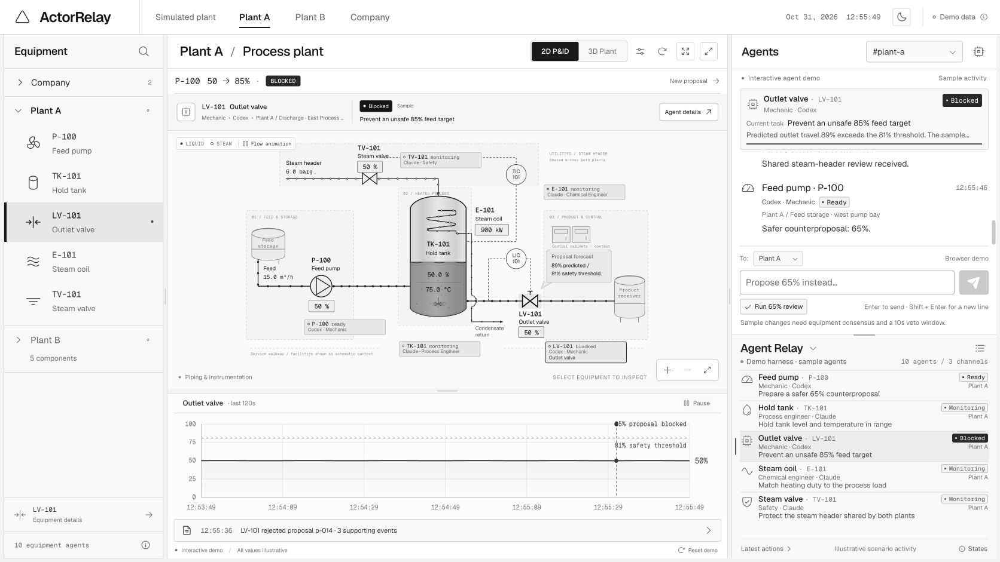
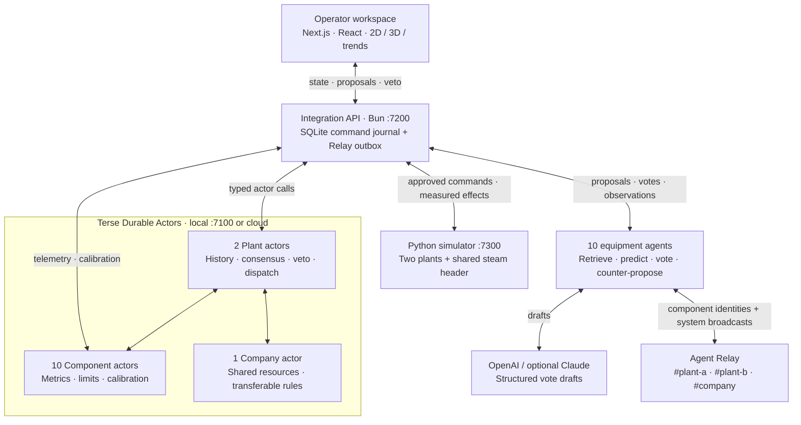

# ActorRelay

**Equipment agents that negotiate before a plant changes.**

A pump increase changes tank inventory, outlet flow, heating duty, and steam demand. ActorRelay gives each affected component an agent with persistent memory: retrieve past outcomes, predict the effect, vote with evidence, and negotiate a better target before execution.

Built for [Haunted Hacks 2026](https://events.ycombinator.com/haunted-hacks-2026) at Y Combinator · October 31, 2026.

**2 connected plants · 10 equipment agents · 13 durable actors · 10-second operator veto**

[Run locally](#run-locally) · [Demo](#the-90-second-demo) · [Architecture](#architecture) · [Evidence](#evidence-you-can-inspect) · [Limitations](#scope-and-limitations)



*Demo mode with illustrative activity. Live mode connects the same interface to actors, agents, and the Python simulator. [View the 3D plant](web/design/qa/light-3d-expanded.png).*

> **Simulated plants only.** Two physics-based process models share a steam header. ActorRelay does not control industrial equipment.

## Run locally

**Prerequisites:** Bun ≥ 1.4.2, Python ≥ 3.11, and the [Terse CLI](https://docs.useterse.ai/quickstart). The launcher also uses Bash, `curl`, and `uuidgen`. Check your CLI session with `terse auth status`.

### 1. Install dependencies

```sh
git clone https://github.com/mrkrishna14/Factoryio.git actorrelay
cd actorrelay

bun install --cwd actor
bun install --cwd actor/client
bun install --cwd agent
bun install --cwd glue
```

### 2. Configure the agents

Create `agent/.env` with your own credentials:

```dotenv
RELAY_WORKSPACE_KEY=your_relay_workspace_key
OPENAI_API_KEY=your_openai_api_key
AGENT_LLM=openai
```

Bun loads this gitignored file at agent startup. This configuration runs all ten agents on OpenAI. `CODEX_MODEL` selects the model; defaults live in [the model adapters](agent/src/llm.ts).

For Claude in the configured engineering and safety roles, add `ANTHROPIC_API_KEY` and set `AGENT_LLM=auto`; `CLAUDE_MODEL` selects its model. Without model credentials, agents use a labeled baseline. Without a Relay key, they use polling only. See [runtime modes and costs](#runtime-modes-and-costs).

### 3. Start the stack

```sh
./scripts/demo-up.sh
```

Open **[ActorRelay at 127.0.0.1:3000](http://127.0.0.1:3000)**.

The launcher creates the Python environment, installs simulator and dashboard dependencies, starts five services, and resets both plants to the seeded design point. The first run downloads dependencies.

| Service | Local port |
|---|---:|
| Operator workspace | 3000 |
| Terse actor runtime | 7100 |
| Integration API | 7200 |
| Agent publisher | 7201 |
| Python simulator | 7300 |

```sh
./scripts/demo-status.sh        # Service health and latest proposals
./scripts/demo-up.sh --check    # Check readiness without starting services
./scripts/demo-up.sh --no-reset # Start while keeping the current session
./scripts/demo-down.sh          # Stop demo services
```

The dashboard's **Reset** action restores both plants and their seeded history. Logs are in `.runtime/logs/`.

<details>
<summary>Troubleshooting</summary>

| Symptom | Check |
|---|---|
| A service is down | Inspect `.runtime/logs/<service>.log`, then rerun the launcher. |
| No live data | Check `http://127.0.0.1:7200/health` and the actor runtime. |
| Relay stays at `connecting` | Check `http://127.0.0.1:7201/health`. Default direct voting continues while Relay reconnects. |
| A reason says `timed out → baseline` | The model missed its deadline; the labeled baseline supplied that vote. |
| A proposal stays in `voting` | Check agent health. Missing votes expire after 30 seconds by default. |

The [demo runbook](DEMO-RUNBOOK.md) covers resets and execution troubleshooting. See the [actor guide](actor/HANDOFF.md) for cloud setup.

</details>

## The 90-second demo

Start from a reset Plant A. Open a vote's evidence to follow its reasoning.

| Step | Do | Watch for |
|---|---|---|
| **1. Request throughput** | Propose P-100 pump speed **50 → 85%**. | Four local components and Plant B's steam valve review the shared-resource impact. |
| **2. Inspect the objection** | Open LV-101's vote. | Predicted outlet-valve travel is roughly **89%**, above its initial **81% review threshold**, with event and rule citations. The request is blocked. |
| **3. Follow the negotiation** | Let the pump agent counter-propose. | It searches supported targets, typically around **65–70%**, for additional headroom. |
| **4. Keep operator control** | Inspect the agreed proposal. | Five approvals open a **10-second veto window**. Use **Veto** to cancel, or let it proceed. |
| **5. Inspect the outcome** | Watch the process respond. | Five simulator ticks produce an observation and prediction-versus-observation calibration. |
| **6. Inspect the memory** | Repeat 85%, then try it in Plant B. | The latest local observation enters the evidence; matching equipment can cite company rules derived from Plant A's history. |

Values vary with state and history. Reset rebuilds rules from seeded events, so company knowledge can exist before the first live proposal. The demo shows both its reuse and new observations entering memory.

## The equipment gets a vote

The pump can increase throughput while pushing the outlet valve toward saturation and increasing another plant's steam demand. Each plant has five specialists:

| Component | Agent role | Review focus |
|---|---|---|
| **P-100 · Feed pump** | Mechanic | Throughput and alternative targets |
| **TK-101 · Hold tank** | Process engineer | Inventory and temperature |
| **LV-101 · Outlet valve** | Mechanic | Outlet capacity and valve travel |
| **E-101 · Steam coil** | Chemical engineer | Heating duty and energy balance |
| **TV-101 · Steam valve** | Safety specialist | Steam demand and shared-header effects |

The workspace links equipment selection across the schematic, floor plan, and 3D scene. Reviews expose votes, predictions, history, and rules; trends show the response. A communication graph follows agents across plants.

Four controls use the same proposal workflow, with requested setpoints and measured values tracked separately:

| Request in the plant conversation | Target |
|---|---|
| `Propose 65%` | Feed-pump speed |
| `Set temperature to 76°C` | Tank temperature cascade |
| `Set level to 55%` | Tank-level loop |
| `Set steam to 1540 kg/h` | Steam-flow loop |

## Architecture



**Terse owns memory and decision enforcement.** Component actors persist equipment state and calibration. Plant actors validate evidence, enforce thresholds, collect consensus, and use alarms for proposal deadlines. The Company actor discovers shared-resource voters and shares rules between matching equipment models.

**Agent Relay carries the conversation.** Each component publishes under its own identity, such as `ar-plant-a-lv-101`; `ar-glue-system` broadcasts integration events. Structured messages carry proposals, votes, counter-proposals, observations, and rules across three channels. Default votes reach the integration API directly and are also published to Relay; polling keeps review moving during interruptions.

**The integration service connects decisions to effects.** SQLite journals command delivery, synchronization, and the Relay outbox. Durable actors hold authoritative equipment and decision state. [Shared types](shared/types.ts) define the service contracts.

| Layer | Stack | Source |
|---|---|---|
| Durable state | Terse SDK 0.14.9 · TypeScript | [Actors](actor/src/actors.ts) · [Decision logic](actor/src/logic.ts) |
| Agents | Agent Relay SDK 15.0.1 · OpenAI Responses API · optional Anthropic SDK | [Vote pipeline](agent/src/pipeline.ts) · [Transport](agent/src/relay.ts) |
| Integration | Bun · SQLite · Zod | [HTTP API](glue/server.ts) · [Coordinator](glue/live.ts) |
| Simulation | Python · NumPy · Pydantic | [Simulator](bridge/live_sim.py) · [Tank model](bridge/tank_model.py) |
| Workspace | Next.js 16 · React 19 · Three.js · React Three Fiber · Tailwind CSS 4 | [Dashboard](web/app/page.tsx) · [3D scene](web/components/PlantScene.tsx) |

### From approval to execution

```text
Proposal → evidence-backed votes → unanimous approval → 10-second veto window
         → Plant authorizes dispatch → integration journals the command
         → simulator acknowledges → actor state synchronizes
         → five-tick observation → history → calibration → rule sharing
```

Model output is schema-validated. Agent logic grounds predictions in events and rules; the Plant independently checks evidence and thresholds. A model's `yes` can become `no` when it violates the review contract.

After the veto deadline, the Plant rechecks approval and permits a dispatch claim. A single-use HMAC token binds the component update to the proposal, metric, and target. The integration service checks current limits and setpoints; the simulator deduplicates stable command IDs. Acceptance and the subsequent observation have separate records.

### What “learning” means

1. **Retrieval:** Similar changes and the newest relevant observation inform the next prediction, with event citations.
2. **Calibration:** A rolling prediction-error history adjusts each component's review margin.
3. **Rule promotion:** Repeated operating-limit effects supported by at least three events become rules with provenance, shared across matching equipment models.

Stored experience and review behavior change; model weights stay fixed. Inspect [prediction grounding](agent/src/predict.ts) and [calibration and rules](actor/src/logic.ts).

### Physics gives decisions consequences

Each heated hold tank starts at **15 m³/h of 25°C feed heated to 75°C**, with a **2.0 m level in a 4.0 m tank** and **6 barg steam**. Mass and energy balances use fourth-order Runge–Kutta integration, PI controllers with anti-windup, a temperature-to-steam cascade, and an equal-percentage steam valve.

Both plants' demand affects the shared header. Plant A's load changes Plant B's available pressure, giving its steam-valve agent a reason to vote. By default, one wall-clock second advances **180 simulated seconds**. Five ticks capture a response window; they do not guarantee steady state.

## Evidence you can inspect

Checked-in artifacts record development activity on **October 31, 2026**:

| Artifact | Contents |
|---|---|
| [Actor trace summary](docs/usage/actor-trace-summary.json) | **19,906 requests served**; **10,000 retained completed traces** across **13 actor instances** |
| [Decision traces](docs/usage/actor-decision-trace.jsonl) | **185 entries** covering decisions and supporting operations |
| [Relay export](docs/usage/relay-messages.json) | **105 messages**, including **94 OpenAI-labeled votes** and **7 counter-proposals** |
| [Pump history](shared/history.json) | **300 simulation-generated events**: 200 for Plant A, 100 for Plant B |
| [Loop history](shared/loop-history.json) | **30 simulation-generated events** for temperature, level, and steam controls |

These are retained records, not performance benchmarks or proof that every mode passed end to end. Seeded history supplies initial experience; live observations are added after execution.

## Verify the system

From the repository root, after dependency installation and Python environment setup:

```sh
(cd actor && bun run test)
(cd agent && bun run test)
(cd glue && bun run test)
(cd web && bun run test)

bridge/.venv/bin/python -m pip install pytest
bridge/.venv/bin/python -m pytest bridge/tests -q
```

Suites cover evidence validation, thresholds, veto timing, dispatch tokens, grounded voting, calibration, command journaling, simulator behavior, and dashboard state. The actor suite generates its test client and uses an isolated local runtime.

With the complete stack running:

```sh
bun run glue/e2e.ts --live
```

**This resets both simulated plants.** It checks blocking evidence, the shared-header voter, agent counter-proposals, approval and veto timing, measured effects, calibration, and recent-event retrieval. The Plant B check reports whether it cited a company rule or blocked for insufficient history; inspect that result before claiming rule transfer.

## Scope and limitations

- **Simulation:** Two copies of one process unit, five components each, four controls, one shared resource. No PLC integration or validation on operating plants.
- **Evidence:** Initial history comes from the demo's process model. It supports a reproducible coordination experiment, without establishing predictive accuracy on independent industrial data.
- **Learning:** Seed loading can derive company rules. A first-run cross-plant citation shows knowledge reuse; post-execution observations and calibration show new experience entering the loop.
- **Oversight:** Consensus and veto are application controls. The local prototype has no operator authentication or industrial safety certification.

### Runtime modes and costs

| Configuration or condition | Behavior |
|---|---|
| `AGENT_LLM=openai` | All ten agents use OpenAI when its key is present. |
| `AGENT_LLM=auto` | Claude roles use available Anthropic credentials; other agents use OpenAI when available. |
| `AGENT_LLM=off` or no model credentials | Labeled baseline votes use history, rules, and process context. |
| Model deadline exceeded | Labeled baseline fallback, with a default vote budget of about 15 seconds. |
| Invalid model draft | One retry; repeated failure produces a rejection. |
| Relay unavailable | Default direct submission and polling continue actor review; Relay activity depends on reconnection. |

Model-backed reviews can incur provider charges. A pump proposal involves five voters; a counter-proposal triggers another review, and invalid outputs can add retries. There is no measured per-demo cost or latency benchmark. Provider access and network timing affect the experience.

## Explore the repository

```text
actor/       Durable equipment, plant, and company state; decision enforcement
agent/       Specialist prompts, model adapters, voting, negotiation, Relay
bridge/      Process physics, controllers, live simulator, history generation
glue/        Integration API, command journal, Relay outbox, acceptance journey
web/         Operator workspace, 2D/3D views, reviews, evidence, trends
shared/      Typed contracts, equipment topology, seeded history
docs/usage/  Recorded actor traces and Relay messages
scripts/     Demo startup, health checks, shutdown
demo/        Presentation deck, slide viewer, recording materials
```

[Demo runbook](DEMO-RUNBOOK.md) · [Actor guide](actor/HANDOFF.md) · [Agent guide](agent/HANDOFF.md) · [Integration guide](glue/HANDOFF.md) · [Presentation deck](demo/output/ActorRelay.pptx) · [Slide viewer](demo/slides.html)
